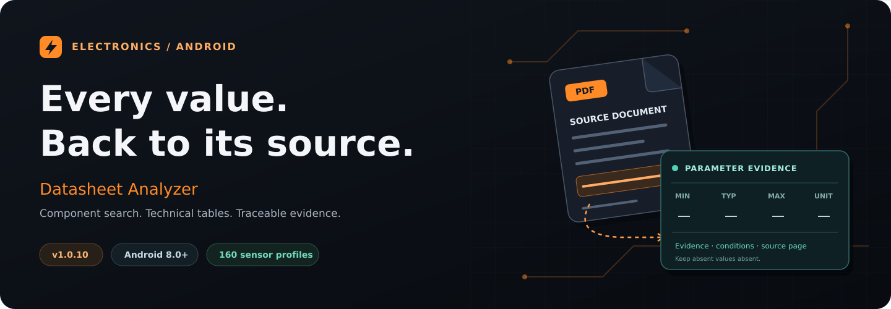

# Datasheet Analyzer

<p align="center">
  
</p>

<p align="center">
  <strong>An Android companion for electronics students and component research.</strong><br>
  Search a part. Read its datasheet. Trace the result to the source.
</p>

<p align="center">
  <a href="docs/README_TR.md">Türkçe</a> ·
  <a href="#getting-started">Getting started</a> ·
  <a href="docs/ARCHITECTURE.md">Architecture</a> ·
  <a href="sensor-catalog/README.md">Sensor catalogue</a> ·
  <a href="docs/VALIDATION.md">Validation</a>
</p>

**Datasheet Analyzer** brings component discovery, PDF inspection and technical-parameter analysis into one Kotlin Android application. Supported results include **minimum / typical / maximum values, units, operating conditions, evidence lines and source pages**.

The application keeps recommended operating conditions separate from absolute maximum ratings. Missing or ambiguous values are not filled in with invented specifications.

## What you can do

| Capability | In the application |
| --- | --- |
| **Find a component** | Enter a part number or read it from a component with on-device camera OCR. |
| **Open a datasheet** | Search recognised sources, prioritise manufacturer PDFs or choose a local document. |
| **Read technical tables** | Query parameters in Turkish or English and inspect values together with conditions and source evidence. |
| **Inspect graphs** | Search up to three figure titles; preview source pages and save a page or selected region as PNG. |
| **Keep and share results** | Export PDF/CSV reports, save analyses with notes and compare saved components. |
| **Explore sensor alternatives** | Browse **160 sensor profiles** with manufacturer references and compare candidate specifications. |

Sensor suggestions carry compatibility conditions and review labels. An alternative in the catalogue is not automatically a drop-in replacement.

## From query to evidence

A part number or local PDF starts the analysis. Source and document-identity checks lead to native PDF text or targeted OCR. Supported values are then presented with their conditions, evidence lines and source pages before export.

PDF parsing and previews run through a separate isolated Android service. The sensor catalogue is maintained as a separate feature module. [Explore the architecture →](docs/ARCHITECTURE.md)

## Sensor catalogue

The catalogue contains **160 models across five manufacturers**. Entries link to manufacturer documents and evidence pages; package suffixes are not counted as extra models.

| Manufacturer | Profiles |
| --- | ---: |
| Texas Instruments | 69 |
| STMicroelectronics | 62 |
| Analog Devices | 18 |
| Sensirion | 6 |
| Bosch | 5 |

[Catalogue maintenance](sensor-catalog/README.md) · [Source records](SENSOR_KAYNAKLARI.json)

## Getting started

| Requirement | Version |
| --- | --- |
| Android | 8.0+ / API 26+ |
| JDK | 17 |
| Android SDK platform | 36 |
| Android Gradle Plugin | 8.12.0 |
| Gradle wrapper | 8.13 |
| Kotlin | 2.2.10 |

Clone the project, open its root in Android Studio and select JDK 17 for Gradle:

```bash
git clone https://github.com/kmli1/Datasheet-Analyzer.git
cd Datasheet-Analyzer
```

Install SDK platform 36, synchronise Gradle and run the `app` configuration on a device or emulator. Debug signing uses Android's local default key unless an optional local test key is supplied. [Signing notes](signing/README.md)

<details>
<summary><strong>Build and verification commands</strong></summary>

Windows PowerShell:

```powershell
.\gradlew.bat :app:assembleDebug
.\gradlew.bat :app:testDebugUnitTest :app:lintDebug
```

Linux / macOS:

```bash
./gradlew :app:assembleDebug
./gradlew :app:testDebugUnitTest :app:lintDebug
```

Catalogue and protected-source checks:

```bash
python3 scripts/generate_sensor_catalog.py --check
sha256sum -c ALGORITMA_KORUMA_1.0.10.sha256
```

The debug APK is written to `app/build/outputs/apk/debug/app-debug.apk`. These are build instructions; current verification is documented separately.

</details>

## Project structure

| Path | Responsibility |
| --- | --- |
| [`app/src/main/`](app/src/main/) | Android UI, source search, PDF/OCR, analysis and exports |
| [`features/sensoralternatives/`](app/src/main/java/com/example/datasheetanalyzer/features/sensoralternatives/) | Sensor browsing and comparison |
| [`app/src/test/`](app/src/test/) | Unit and regression tests |
| [`app/src/androidTest/`](app/src/androidTest/) | Device tests and synthetic PDF fixtures |
| [`sensor-catalog/`](sensor-catalog/) | Reviewed catalogue data and evidence audit |
| [`docs/`](docs/README.md) | Usage, architecture, validation and project history |
| [`store-assets/`](store-assets/) | Existing store artwork and publication drafts |

## Project status

The source version is **1.0.10** (`versionCode 18`). The archived release record reports **358 passed tests, 7 skipped tests and 0 lint errors**. The repository presentation update restores omitted source/test files and does not change the existing PDF/OCR algorithms.

**A full Android build and device run were not repeated for this update.** No GitHub Release is published at the time of this documentation update. Read [validation and known limitations](docs/VALIDATION.md) for the scope of each check.

## Contributing

Focused improvements, reproducible bug reports and catalogue corrections are welcome. Start with [CONTRIBUTING.md](CONTRIBUTING.md); issue and pull-request templates are included. Sensitive reports belong in the channels described by [SECURITY.md](SECURITY.md).

[Changelog](CHANGELOG.md) · [Privacy information](app/src/main/assets/privacy-tr.txt) · [Third-party notices](app/src/main/assets/third-party-notices.txt)

A project-wide licence has not been selected. Third-party components retain their own licences.

---

Developed as an AI agents course project. [Development roles](docs/AI_WORKFLOW.md) · Maintained by [@kmli1](https://github.com/kmli1).
