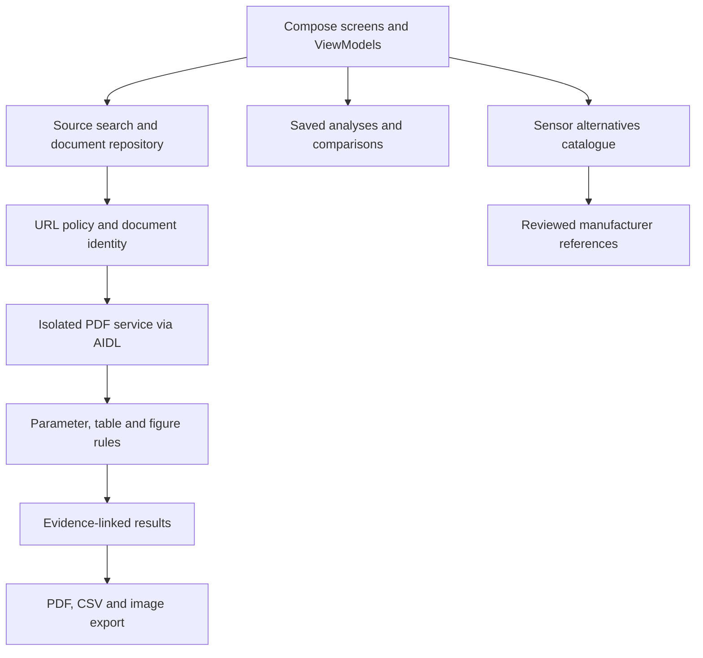

# Architecture

[← Project overview](../README.md) · [Validation](VALIDATION.md)

The application separates source discovery, document verification, PDF processing and result presentation. Sensor alternatives are maintained independently from the main extraction engine.

## Module map

Paths below are relative to `app/src/main/java/com/example/datasheetanalyzer/`.

| Directory | Responsibility |
| --- | --- |
| `ui/` | Home, scanner, search, results, local library, workspace and navigation |
| `data/network/` | HTML fetching and source-provider transport |
| `data/download/` | PDF downloads and local document import |
| `data/cache/` | Verified document cache and recent searches |
| `data/workspace/` | Saved analysis records, notes and comparisons |
| `domain/resolver/` | Source candidates, domain handling and URL policy |
| `domain/document/` | Document identity, processing plans and analysis models |
| `domain/extraction/` | Query matching, electrical values, conditions and table layout |
| `domain/security/` | Document limits and safety checks |
| `sandbox/` | Separate-process PDF parsing, rendering and OCR support |
| `ocr/` | Component-code recognition and candidate handling |
| `features/sensoralternatives/` | Catalogue, filtering, candidate selection and comparison UI |
| `export/` | Reports, CSV and image staging |

AIDL contracts live under `app/src/main/aidl/`. Privacy and third-party notices live under `app/src/main/assets/`.

## Design boundaries

**Source identity.** A trusted host alone is insufficient. Technical results depend on document identity, read coverage and available evidence.

**Operating context.** Recommended operating conditions and absolute maximum ratings remain separate. Blank table cells retain their positions; absence is not a value.

**PDF work.** Parsing and previews use an isolated service. Native text is preferred, with limited OCR when needed. Bounds and verification policies remain part of the processing pipeline.

**Sensor data.** `sensor-catalog/` contains the expanded catalogue and its audit. `scripts/generate_sensor_catalog.py` produces the Kotlin catalogue. Manufacturer evidence and compatibility conditions remain attached to candidate profiles.

**Local files.** Cache limits and staged export files are distinct from files saved by the user through Android's document picker.

## This repository update

Existing application source files are preserved byte for byte. Two omitted cache sources and 16 synthetic PDF fixtures are restored from the previous 1.0.10 source package. The Gradle adjustment only allows the optional local debug key to be absent; the PDF/OCR engine and catalogue logic are unchanged.
